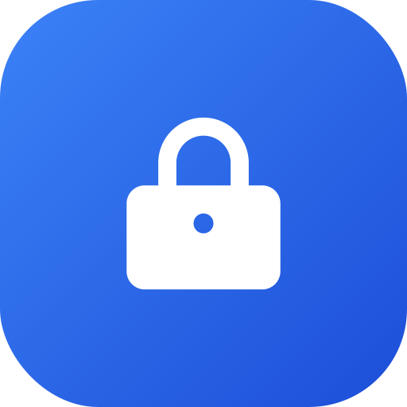

# QuickLock



[](https://github.com/thangvt-food/quick-lock/actions/workflows/build.yml)

Chạm **một lần** vào biểu tượng ổ khóa trên Home Screen hoặc Dock → màn hình khóa ngay.
Không root, không Device Administrator, không Shizuku, không Internet, không quảng cáo, không tracking.

| Thông số | Giá trị |
| --- | --- |
| Package | `com.quicklock.app` |
| Ngôn ngữ | Kotlin, Jetpack Compose |
| minSdk / targetSdk / compileSdk | 26 / 35 / 35 |
| Quyền khai báo | **không có quyền hệ thống nào** (xem mục 6) |
| Kích thước APK debug | ~8,0 MB (chưa minify) |

---

## 1. Cách hoạt động

```
Người dùng chạm icon ổ khóa
        │
        ▼
LockShortcutAlias  (activity-alias, icon riêng, label "QuickLock")
        │  khởi chạy
        ▼
LockActivity  (Activity trong suốt, không có UI, không có layout)
        │  LockAccessibilityService.lockScreen()
        ▼
AccessibilityService.performGlobalAction(GLOBAL_ACTION_LOCK_SCREEN)
        │
        ▼
Màn hình tắt + khóa  →  LockActivity.finishAndRemoveTask()
```

* **`LockShortcutAlias`** là một `activity-alias` có intent-filter `MAIN/LAUNCHER` và icon riêng.
  Vì nó là một *icon ứng dụng thật*, mọi launcher (kể cả HyperOS) cho phép đặt nó trên
  Home Screen **và kéo vào Dock**, và icon không bị mất sau khi đóng app, reboot hay
  cập nhật app.
* **`LockActivity`** không gọi `setContentView`, dùng theme trong suốt
  (`Theme.QuickLock.Lock`, tắt preview/starting window/animation) và `finishAndRemoveTask()`
  ngay sau khi khóa. Người dùng chỉ thấy màn hình tắt, không thấy app mở ra.
* **`LockAccessibilityService`** chỉ làm đúng một việc: `GLOBAL_ACTION_LOCK_SCREEN`
  (API 28+). Service khai báo **0 event type**, `canRetrieveWindowContent=false`,
  `canPerformGestures=false`, và ở runtime còn gọi `setServiceInfo()` để ép
  `eventTypes = 0`. Nó không đọc nội dung màn hình, không đọc text, không theo dõi app khác.
* **`ShortcutManager`** được dùng thêm hai chỗ: shortcut ghim được
  (`requestPinShortcut`, nút "Thêm biểu tượng khóa ra màn hình chính") và shortcut
  trong menu nhấn giữ icon app. Cả hai đều trỏ thẳng vào `LockActivity`.

### Vì sao cần một Activity?

Launcher shortcut **bắt buộc** phải trỏ tới một Activity (từ Android 10 không thể phát
broadcast/service trực tiếp từ shortcut). `LockActivity` được thiết kế để **không hiển thị gì**:
window trong suốt, không preview, không animation, và kết thúc ngay trong `onCreate`.
Đây là cách duy nhất dùng API công khai, không reflection, không root.

---

## 2. Tải và cài đặt

**Cách 1 — GitHub Release:** tải `app-debug.apk` ở mục
[Releases](https://github.com/thangvt-food/quick-lock/releases).

**Cách 2 — GitHub Actions artifact:** tab *Actions* → run mới nhất →
*Artifacts* → `quicklock-debug-apk`.

**Cách 3 — tự build** (xem mục 3).

Cài bằng ADB hoặc mở file APK trên điện thoại (Cho phép cài từ nguồn không xác định).

```bash
adb install -r app-debug.apk
```

> APK được ký bằng **debug key công khai** (`keystore/quicklock-debug.jks`, mật khẩu
> `android`). Key này cố tình commit vào repo để mọi bản build CI có cùng chữ ký →
> cài đè/cập nhật không cần gỡ app. Đây không phải key để phát hành lên Play Store.

---

## 3. Build

Yêu cầu: JDK 17+ và Android SDK platform 35 + build-tools 35.

```bash
export ANDROID_HOME=$HOME/Android/Sdk   # hoặc đường dẫn SDK của bạn
./gradlew assembleDebug
# APK: app/build/outputs/apk/debug/app-debug.apk
```

Trên GitHub: push lên `main` (hoặc bấm *Run workflow*) là CI build + audit + upload APK.
Push tag `v*` sẽ tạo Release kèm APK.

CI thực hiện thêm bước `./gradlew lintDebug` (lint là **blocking**, 0 error) và
`scripts/verify-apk.sh`, script này **fail build** nếu:
* package name / minSdk / targetSdk không đúng,
* APK khai báo quyền nào ngoài quyền tự định nghĩa mức signature nêu ở mục 6,
* manifest thiếu `MainActivity`, `LockActivity`, `LockShortcutAlias`,
  `LockAccessibilityService` hoặc `BIND_ACCESSIBILITY_SERVICE`,
* accessibility config khai báo event type / quyền đọc nội dung cửa sổ / gesture,
* còn sót `androidx.profileinstaller.ProfileInstallReceiver` (đã bị strip),
* chữ ký APK không hợp lệ.

---

## 4. Cấp quyền Accessibility (một lần duy nhất)

Android không cho app tự cấp quyền này, nên phải làm thủ công:

1. Mở **QuickLock Settings** (icon bánh răng/xám) → bấm **Enable accessibility**.
2. Trên HyperOS 3: **Settings → Additional settings → Accessibility → Downloaded apps → QuickLock**.
3. Bật công tắc → xác nhận hộp thoại cảnh báo của hệ thống.

**Nếu công tắc bị mờ / báo "Restricted setting"** (Android 13+ chặn app cài ngoài
Play Store): **App info → ⋮ → Allow restricted settings**, rồi quay lại bật.

Chi tiết + xử lý sự cố: [docs/ACCESSIBILITY.md](docs/ACCESSIBILITY.md).

---

## 5. Tạo shortcut và đưa vào Dock

**Cách A — kéo icon từ ngăn ứng dụng (khuyên dùng, hoạt động trên mọi launcher):**

1. Mở ngăn ứng dụng (app drawer).
2. Tìm **QuickLock** có icon ổ khóa xanh (đây là `LockShortcutAlias`).
3. Nhấn giữ icon → kéo lên Home Screen, hoặc thả vào vùng **Dock** ở đáy màn hình.
4. Chạm icon một lần → màn hình khóa ngay.

**Cách B — ghim shortcut:**

1. Mở **QuickLock Settings** → **Add lock shortcut to Home screen**.
2. Launcher hiện hộp thoại xác nhận → *Add*.
3. Kéo icon vừa ghim vào Dock.

---

## 6. Quyền ứng dụng

**Không có quyền hệ thống nào.** `AndroidManifest.xml` của dự án không khai báo một
`<uses-permission>` nào. Sau khi merge manifest, chỉ còn đúng **một quyền tự định nghĩa**
do `androidx.core` tự thêm vào:

```xml
<permission
    android:name="com.quicklock.app.DYNAMIC_RECEIVER_NOT_EXPORTED_PERMISSION"
    android:protectionLevel="signature" />
```

Quyền này do chính QuickLock sở hữu, mức `signature` (chỉ app cùng chữ ký mới có),
dùng để chặn app khác gửi broadcast nội bộ vào các thành phần của AndroidX. Nó
**không** cấp quyền truy cập dữ liệu, mạng, danh bạ hay ứng dụng khác.
CI fail build nếu xuất hiện bất kỳ quyền nào khác, hoặc nếu quyền này không ở mức signature.

| Quyền hệ thống | Có? |
| --- | --- |
| `INTERNET` / `ACCESS_NETWORK_STATE` | Không |
| `READ_SMS`, `READ_CONTACTS`, `READ_CALL_LOG` | Không |
| `QUERY_ALL_PACKAGES` | Không |
| `SYSTEM_ALERT_WINDOW` | Không |
| `BIND_DEVICE_ADMIN` | Không |

Quyền trợ năng là *special access* do người dùng bật trong Settings, không phải
`<uses-permission>`, và có thể thu hồi bất cứ lúc nào. Ứng dụng không có SDK mạng,
không Firebase, không Analytics, không Crashlytics, không network request — xem
`app/build.gradle.kts` (chỉ `androidx.core`, `activity-compose`, `lifecycle`, Compose).

---

## 7. Cấu trúc mã nguồn

```
app/src/main/
  java/com/quicklock/app/
    MainActivity.kt                       # màn hình trạng thái / setup
    LockActivity.kt                       # activity trong suốt, khóa + finish
    accessibility/
      LockAccessibilityService.kt         # GLOBAL_ACTION_LOCK_SCREEN, 0 event
    permissions/
      AccessibilityPermissionManager.kt   # đọc trạng thái qua AccessibilityManager
    shortcut/
      LockShortcutManager.kt              # pin + dynamic shortcut
    ui/
      MainScreen.kt                       # Compose UI
      Theme.kt
  res/
    drawable/                             # vector icon (sinh từ assets/quicklock.svg)
    mipmap-anydpi-v26/                    # adaptive icon (2 icon: khóa + settings)
    xml/accessibility_service_config.xml
    values/, values-vi/, values-night/
  AndroidManifest.xml
assets/quicklock.svg                      # nguồn icon
scripts/verify-apk.sh                     # audit APK trong CI
keystore/quicklock-debug.jks              # debug key công khai (ổn định chữ ký)
```

---

## 8. Riêng tư

* Hoạt động offline hoàn toàn; app không có code mạng và không có quyền Internet.
* Không lưu, không thu thập, không truyền dữ liệu nào. Không có file cấu hình,
  không SharedPreferences.
* Accessibility service không nhận event, không đọc nội dung cửa sổ.
* Toàn bộ logic nằm trong ~600 dòng Kotlin, có thể audit trong vài phút.

---

## 9. Giới hạn / ghi chú tương thích

* `GLOBAL_ACTION_LOCK_SCREEN` cần **Android 9 (API 28)+**. App vẫn cài được trên API 26–27
  nhưng chức năng khóa sẽ báo "cần bật trợ năng" thay vì khóa.
* Một số launcher có thể vẽ animation chuyển cảnh rất ngắn trước khi màn hình tắt.
  `LockActivity` không có window hiển thị nên không có giao diện thừa, nhưng
  độ "tức thời" phụ thuộc launcher. Trên HyperOS, tắt animation launcher sẽ làm
  cảm giác nhanh hơn nữa.
* Nếu quyền trợ năng bị hệ thống tắt (một số ROM tiết kiệm pin), app không thể khóa;
  chạm icon sẽ hiện Toast và mở màn hình setup. Bật *Autostart* cho QuickLock trong
  HyperOS để giảm khả năng này.
* Cập nhật app (cài đè) giữ nguyên quyền trợ năng và shortcut vì cùng package + cùng
  chữ ký. Gỡ rồi cài lại thì phải cấp quyền và tạo lại shortcut.
* Báo cáo kiểm thử chi tiết: [docs/TEST-REPORT.md](docs/TEST-REPORT.md).
